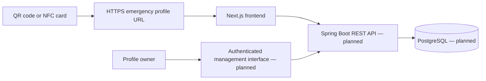

# EMIS — Technology Comparison and Selection Rationale

**Project:** Design and Development of a Privacy-Aware QR/NFC-Based Emergency Medical Information System  

## 1. Purpose and evaluation method

This document compares reasonable technology alternatives for four major design decisions: frontend platform, backend framework, data storage, and QR/NFC access method. Selections are **proposed design decisions**, not claims that the entire system has been implemented or tested. Each option is evaluated against the same decision-specific criteria. Assessments are qualitative engineering judgments to be validated during implementation.

### Project constraints

- Emergency responders should be able to view a **minimal emergency profile** quickly, ideally without installing an app.
- Sensitive data must not be embedded directly in a publicly readable QR code or NFC tag.
- Profile owners need a controlled way to create and update their information.
- The system should support browser-based access on common phones and computers.
- The student team must be able to build, document, and test a demonstrable prototype within the diploma timeline.
- Medical information is user-provided and must not be presented as professionally verified unless independently validated.

## 2. Decision A — Frontend platform

**Criteria:** cross-device reach, installation friction, development speed, maintainability, and support for accessible responsive interfaces.

| Alternative | Advantages | Limitations | Fit for EMIS |
|---|---|---|---|
| **Next.js + React + TypeScript** | Responsive web access without installation; component reuse; TypeScript helps manage data contracts; fits the existing prototype | Requires careful server/client boundaries, secure configuration, and accessibility testing | **Selected for prototype** |
| React single-page application with Vite | Lightweight tooling; straightforward frontend development | Routing, server-side features, and deployment conventions need separate choices | Viable alternative |
| Flutter mobile application | Consistent native-like mobile UI; potential access to device integrations | Requires installation for the primary experience; more platform-specific testing | Less suitable for emergency public access |

**Decision:** Continue with **Next.js, React, TypeScript, and Tailwind CSS**. This matches the current frontend work and supports opening an emergency profile through an ordinary mobile browser. A responsive website is a design choice, not evidence that all devices have been tested.

## 3. Decision B — Backend framework

**Criteria:** REST API support, access-control ecosystem, team familiarity, maintainability, and integration with relational storage.

| Alternative | Advantages | Limitations | Fit for EMIS |
|---|---|---|---|
| **Java + Spring Boot** | Mature REST API and validation ecosystem; Spring Security options; structured service architecture | More initial configuration and boilerplate; requires secure setup | **Proposed selection** |
| Node.js + NestJS | TypeScript across frontend and backend; modular architecture; strong API development workflow | Security and configuration still require careful implementation; would change assigned backend stack | Good alternative |
| Python + FastAPI | Concise API definitions; automatic OpenAPI documentation; rapid prototyping | Different language ecosystem; team would need to establish conventions for persistence and authorization | Good alternative |

**Decision:** Propose **Java + Spring Boot** for the backend, with Maven for dependency management. No completed backend API is claimed at this pre-defense stage.

## 4. Decision C — Data storage

**Criteria:** consistency of profile and access data, query flexibility, schema clarity, backup practices, and compatibility with the proposed backend.

| Alternative | Advantages | Limitations | Fit for EMIS |
|---|---|---|---|
| **PostgreSQL** | Relational integrity; transactions; mature tooling; clear relationships between profiles, contacts, and access policies | Schema migrations and operations require planning | **Proposed selection** |
| MySQL | Mature relational database; broad hosting and tooling support | Differences in SQL behavior and operational preferences must be considered | Suitable alternative |
| MongoDB | Flexible document structure; convenient nested records | Relationships and consistency rules require careful modeling; flexibility can weaken schema discipline | Possible but less preferred |

**Decision:** Propose **PostgreSQL** for structured records. A preliminary schema may include `users`, `medical_profiles`, `allergies`, `medications`, `emergency_contacts`, `public_profile_tokens`, and `audit_events`. This is a draft, not an implemented database design. Minimize stored data and define retention/deletion behavior before production.

## 5. Decision D — Emergency access mechanism

**Criteria:** smartphone compatibility, cost, usability in emergencies, replaceability, and risk of exposing sensitive data.

| Alternative | Advantages | Limitations | Fit for EMIS |
|---|---|---|---|
| **QR code pointing to a controlled HTTPS profile** | Widely supported by phone cameras; inexpensive to print; works without a dedicated app | Requires camera and internet access; printed codes can be copied or damaged | **Primary proposed access method** |
| NFC tag containing a controlled HTTPS profile URL | Convenient tap interaction on compatible devices; useful as a second access path | Device support and scanning behavior vary; tag can be cloned or replaced; requires compatible reader | **Optional complementary method** |
| QR/NFC storing full medical data directly | Potentially accessible without a server in some designs | Exposes information to anyone who reads the tag; updates and revocation are difficult; NFC capacity may be limited | **Rejected for sensitive information** |

**Decision:** Use a **QR code as the primary access method**, with **NFC as an optional complementary method**. Both should point to a managed HTTPS URL, not store raw medical details. The public emergency view must expose only explicitly approved information. A URL token is not a substitute for authentication when accessing private data; token guessing, sharing, revocation, and rate limiting require threat-model review.

## 6. Proposed system interaction

**Current boundary:** A sample frontend emergency-profile UI has been developed. The diagram shows the **target architecture**; it does not mean the backend, database, owner authentication, or QR/NFC flow are currently operational.

## 7. Preliminary security and privacy requirements

1. Use HTTPS for all profile and API traffic in deployed environments.
2. Separate the minimal emergency view from owner-only data and management operations.
3. Authenticate owners and enforce server-side authorization on every private-data endpoint.
4. Avoid including names, diagnoses, medications, or other sensitive details directly in QR/NFC payloads.
5. Apply input validation, safe error handling, dependency updates, and secrets management.
6. Design revocation/rotation of public-profile links and access logging with appropriate privacy limits.
7. Provide clear labeling that data may be self-reported and may be incomplete or outdated.
8. Obtain supervisor guidance and review applicable privacy/data-protection obligations before handling real patient information.

These are **requirements and plans**, not a certification of security compliance.

## 8. Planned validation

| Decision | Evidence to collect |
|---|---|
| Next.js frontend | Responsive tests on common phone and desktop sizes; keyboard and screen-reader checks |
| Spring Boot backend | API contract, unit/integration tests, validation and authorization tests |
| PostgreSQL | Schema/ER diagram, migration scripts, referential integrity tests, backup/restore exercise |
| QR/NFC access | Scanning tests on multiple devices, broken-link and revoked-link scenarios, usability observations |
| Privacy controls | Public/private field review, access-control tests, threat-model checklist |

## 9. Decision summary

| Area | Proposed technology | Status |
|---|---|---|
| Frontend | Next.js + React + TypeScript + Tailwind CSS | Initial UI implemented |
| Backend | Java + Spring Boot + Maven | Planned; architecture documented |
| Database | PostgreSQL | Planned |
| API style | HTTPS REST/JSON | Planned |
| Emergency entry point | QR URL, optional NFC URL | Planned |
| Source control and tracking | GitHub and YouTrack | In use |

## 10. Limitations and next steps

This comparison is a **preliminary engineering assessment**, not a benchmark. No quantitative performance, cost, or security comparison has yet been performed. Before final selection, the team should confirm deployment constraints, device support, privacy obligations, and supervisor feedback. Next deliverables: API contract, system context/use-case/component diagrams, ER diagram, security threat model, and prototype testing plan.
